# ssm宁夏大学生燕宝资助金发放管理系统

> 🎓 **计算机毕业设计 · ssm宁夏大学生燕宝资助金发放管理系统**
>
> 本仓库只放**项目介绍 + 运行截图**（截图是站点带水印的原图，存在仓库 `images/` 里）。
>
> 👉 **完整可运行源码 / 数据库脚本 / 部署文档：[点我获取](https://geekcode.top/archives/ssm%E5%AE%81%E5%A4%8F%E5%A4%A7%E5%AD%A6%E7%94%9F%E7%87%95%E5%AE%9D%E8%B5%84%E5%8A%A9%E9%87%91%E5%8F%91%E6%94%BE%E7%AE%A1%E7%90%86%E7%B3%BB%E7%BB%9F?utm_source=github)**
>
> 💬 咨询微信：**ir9372**　|　🌐 更多项目：[极客代码 geekcode.top](https://geekcode.top/?utm_source=github)
>
> 📌 项目详情页：<https://geekcode.top/archives/ssm%E5%AE%81%E5%A4%8F%E5%A4%A7%E5%AD%A6%E7%94%9F%E7%87%95%E5%AE%9D%E8%B5%84%E5%8A%A9%E9%87%91%E5%8F%91%E6%94%BE%E7%AE%A1%E7%90%86%E7%B3%BB%E7%BB%9F?utm_source=github>

<table><td width="230" align="center"> <b>扫码加微信 ir9372</b></td><td valign="middle">📦 源码 = 项目介绍 + 全部运行截图 + 数据库 + 部署文档 👉 点上方任意截图，直接跳到 <b>极客代码 geekcode.top</b> 详情页</td></table>

---

<h1>ssm宁夏大学生燕宝资助金发放管理系统</h1>
<h2>项目概述</h2>

本项目为“宁夏大学生燕宝资助金发放管理系统”，旨在通过信息化手段规范高校学生资助金的申请、审核与发放流程。系统核心功能涵盖用户注册登录、学生信息录入、教师信息管理、资助申请提交、银行卡变更申请、留言反馈及新闻通知发布等模块。适用人群主要为宁夏大学的学生、负责资助管理的教师及系统管理员。技术架构采用经典的 SSM（Spring + Spring MVC + MyBatis）框架，前端使用 JSP 进行页面渲染，后端基于 Java 语言开发，数据存储依赖 MySQL 数据库。该系统解决了传统纸质化或分散式管理中存在的效率低下、数据易丢失及流程不透明等问题，实现了资助业务的数字化闭环管理。

<h2>技术架构</h2>

本系统采用分层架构设计，严格遵循 MVC 设计模式，确保代码的高内聚低耦合。

<strong>1. 表现层 (Presentation Layer)</strong>
基于 JSP (JavaServer Pages) 技术构建前端界面。JSP 页面通过标签库和 EL 表达式展示后端传递的数据模型，处理用户交互请求。由于项目类型为 JSP，未采用前后端分离架构，页面渲染逻辑主要在服务器端完成。

<strong>2. 控制层 (Controller Layer)</strong>
由 Spring MVC 框架负责。控制器接收 HTTP 请求，解析参数，调用业务层服务，并根据处理结果返回相应的视图名称或重定向路径。主要路由包括各类列表页（如 <code>allusers</code>, <code>shenqingzizhu</code> 等）及编辑操作接口。

<strong>3. 业务层 (Service Layer)</strong>
基于 Spring 框架实现。负责具体的业务逻辑处理，如资助申请的合法性校验、状态流转、权限判断等。Spring 的 IOC（控制反转）容器管理各组件的生命周期，AOP（面向切面编程）用于处理日志记录、事务管理等横切关注点。

<strong>4. 持久层 (DAO Layer)</strong>
采用 MyBatis 框架作为 ORM 工具。通过 XML 映射文件或注解将 Java 对象与 SQL 语句绑定，实现对 MySQL 数据库的高效访问。MyBatis 提供了灵活的 SQL 定制能力，适合复杂查询场景，如多条件筛选资助记录。

<strong>5. 数据库设计要点</strong>
数据库选用 MySQL。根据截图中的实体列表，核心表结构应包含：

<ul>
<li><strong>用户表 (<code>yonghuzhuce</code>/<code>allusers</code>)</strong>：存储账号、密码、角色类型。</li>
<li><strong>学生信息表 (<code>xueshengxinxi</code>)</strong>：关联用户 ID，存储学号、姓名、院系等。</li>
<li><strong>教师信息表 (<code>jiaoshixinxi</code>)</strong>：存储教师工号、所属部门等。</li>
<li><strong>资助信息表 (<code>zizhuxinxi</code>/<code>zzxx</code>)</strong>：定义资助项目标准、金额、申请条件。</li>
<li><strong>申请表 (<code>shenqingzizhu</code>)</strong>：记录学生的具体申请内容、状态（待审、通过、驳回）。</li>
<li><strong>银行卡变更表 (<code>shenqinggenghuanyinxingka</code>)</strong>：专门处理收款账户修改请求。</li>
<li><strong>互动模块表</strong>：包括留言 (<code>liuyanban</code>/<code>lyb</code>)、评论 (<code>pinglun</code>)、收藏 (<code>shoucangjilu</code>)。</li>
<li><strong>基础信息表</strong>：新闻通知 (<code>xinwentongzhi</code>)、院系信息 (<code>yuanxixinxi</code>)、友情链接 (<code>youqinglianjie</code>)。</li>
</ul>
<h2>功能模块</h2>

根据提供的页面截图列表，系统功能划分为以下主要模块：

<strong>1. 身份认证与注册模块</strong>

<ul>
<li><strong>登录页</strong>：提供用户名和密码输入框，验证用户身份并建立会话。</li>
<li><strong>用户注册 (<code>yonghuzhuce</code>)</strong>：允许新用户填写基本信息创建账号，通常涉及角色选择（学生/教师）。</li>
<li><strong>所有用户管理 (<code>allusers</code>)</strong>：后台可见的全量用户列表，支持查看和管理所有注册用户。</li>
</ul>

<strong>2. 基础信息管理模块</strong>

<ul>
<li><strong>学生信息 (<code>xueshengxinxi</code>)</strong>：维护学生的详细档案，包括个人资料和学籍信息。</li>
<li><strong>教师信息 (<code>jiaoshixinxi</code>)</strong>：维护参与资助审核的教师资料。</li>
<li><strong>院系信息 (<code>yuanxixinxi</code>)</strong>：配置学校下属院系的元数据，供其他模块引用。</li>
<li><strong>新闻通知 (<code>xinwentongzhi</code>)</strong>：发布关于资助政策变动、截止日期等重要公告。</li>
<li><strong>友情链接 (<code>youqinglianjie</code>)</strong>：展示相关外部网站链接，便于获取更多信息。</li>
</ul>

<strong>3. 资助业务核心模块</strong>

<ul>
<li><strong>资助信息 (<code>zizhuxinxi</code> / <code>zzxx</code>)</strong>：定义具体的资助项目类别、标准及说明。这是学生发起申请的基础数据源。</li>
<li><strong>资助申请 (<code>shenqingzizhu</code>)</strong>：学生根据现有资助项目提交申请材料；教师或管理员在此列表中进行审核、批准或拒绝操作。</li>
<li><strong>银行卡变更申请 (<code>shenqinggenghuanyinxingka</code>)</strong>：针对已获批资助但需更改收款账户的情况，提供专门的变更申请通道及审批流程。</li>
</ul>

<strong>4. 互动与辅助模块</strong>

<ul>
<li><strong>留言板 (<code>liuyanban</code> / <code>lyb</code>)</strong>：提供公共交流区域，用户可发布疑问或建议。</li>
<li><strong>评论 (<code>pinglun</code>)</strong>：针对特定内容（如新闻或资助项目）发表简短评价。</li>
<li><strong>收藏记录 (<code>shoucangjilu</code>)</strong>：用户可将感兴趣的资助项目或通知加入收藏夹，方便后续快速访问。</li>
<li><strong>编辑功能 (<code>页面-编辑 (admin)</code>)</strong>：后台管理员对各类数据进行增删改查的统一入口。</li>
</ul>
<h2>用户角色与权限</h2>

基于 SSM 系统的常规设计及截图中的实体关系，推测存在以下三种主要角色及其权限范围：

<table>
<thead>
<tr>
<th align="left">角色</th>
<th align="left">权限描述</th>
<th align="left">可访问功能模块</th>
</tr>
</thead>
<tbody><tr>
<td align="left"><strong>系统管理员</strong></td>
<td align="left">拥有最高权限，负责系统整体运维、基础数据配置及全局监控。</td>
<td align="left">- <strong>全部用户管理</strong>：查看、禁用或删除任何账号。- <strong>基础数据维护</strong>：编辑院系信息、教师信息、新闻通知、友情链接。- <strong>资助规则制定</strong>：创建和修改资助信息 (<code>zizhuxinxi</code>)。- <strong>最终审核权</strong>：对特殊争议申请进行仲裁或强制状态变更。- <strong>系统配置</strong>：管理后台菜单和权限分配。</td>
</tr>
<tr>
<td align="left"><strong>教师</strong></td>
<td align="left">负责资助申请的初审、复核以及与学生互动的答疑。</td>
<td align="left">- <strong>学生信息查询</strong>：查看所负责学生的基本信息。- <strong>资助审核</strong>：在 <code>shenqingzizhu</code> 列表中查看待审申请，执行通过或驳回操作。- <strong>银行卡变更审核</strong>：处理 <code>shenqinggenghuanyinxingka</code> 中的账户修改请求。- <strong>信息发布</strong>：可能具备发布新闻通知 (<code>xinwentongzhi</code>) 的权限。- <strong>互动回复</strong>：在留言板 (<code>liuyanban</code>) 回复学生提问。</td>
</tr>
<tr>
<td align="left"><strong>学生</strong></td>
<td align="left">资助政策的受益者，主要进行个人信息维护和业务申请。</td>
<td align="left">- <strong>个人中心</strong>：修改自己的学生信息 (<code>xueshengxinxi</code>)。- <strong>浏览资讯</strong>：查看新闻通知、资助信息详情。- <strong>发起申请</strong>：填写并提交 <code>shenqingzizhu</code> 表单。- <strong>变更账户</strong>：若银行卡有误，提交 <code>shenqinggenghuanyinxingka</code> 申请。- <strong>互动功能</strong>：发表留言、评论，以及收藏 (<code>shoucangjilu</code>) 感兴趣的项目。</td>
</tr>
</tbody></table>

<em>注：具体权限粒度（如按钮级控制）未在截图中明确体现，以上基于通用高校管理系统逻辑推导。</em>

<h2>项目特色与创新点</h2>
<ol>
<li><strong>全流程闭环管理</strong>：系统不仅涵盖了传统的“申请-审核”环节，还特别设计了“银行卡变更申请”模块 (<code>shenqinggenghuanyinxingka</code>)。这解决了实际场景中因学生更换银行卡导致资助发放失败的问题，形成了从资格认定到资金到账前最后一道关卡的完整管理链条。</li>
<li><strong>多维度的信息聚合</strong>：除了核心的资助业务，系统集成了新闻通知、院系信息和友情链接，构建了以资助为中心的信息生态。特别是“收藏记录” (<code>shoucangjilu</code>) 功能，提升了用户对重要政策信息的检索效率和关注度。</li>
<li><strong>SSM 经典架构稳定性</strong>：采用经过长期验证的 SSM + JSP 技术栈，虽然非前沿微服务架构，但对于中小型单体应用而言，具有极高的稳定性和较低的开发维护成本，非常适合高校内部行政类系统的快速落地与长期运行。</li>
<li><strong>互动反馈机制</strong>：引入留言板 (<code>liuyanban</code>) 和评论 (<code>pinglun</code>) 模块，打破了传统管理系统单向发布的局限，建立了管理者与学生之间的双向沟通渠道，有助于及时发现政策宣传盲点和系统使用问题。</li>
</ol>
<h2>部署环境</h2>

为确保系统正常运行，需准备以下软硬件环境：

<strong>1. 硬件环境</strong>

<ul>
<li><strong>CPU</strong>: Intel Core i3 及以上处理器</li>
<li><strong>内存</strong>: 4GB RAM 及以上</li>
<li><strong>硬盘</strong>: 至少 10GB 可用空间（用于安装软件及存储数据库文件）</li>
</ul>

<strong>2. 软件环境</strong>

<ul>
<li><strong>操作系统</strong>: Windows 7/10/11 或 Linux (CentOS 7+)</li>
<li><strong>Java 运行环境</strong>: JDK 1.8 (Java SE Development Kit 8)，必须配置 <code>JAVA_HOME</code> 环境变量。</li>
<li><strong>Web 服务器</strong>: Apache Tomcat 8.5 或 9.0 版本。由于是 JSP 项目，需要 Servlet 容器支持。</li>
<li><strong>数据库</strong>: MySQL 5.7 或 8.0 版本。需安装 MySQL Server 及客户端工具（如 Navicat 或 MySQL Workbench）以便导入初始 SQL 脚本。</li>
<li><strong>开发工具 (可选，仅用于二次开发)</strong>: IntelliJ IDEA 或 Eclipse Enterprise Edition, Maven 3.6+ (用于依赖管理)。</li>
</ul>

<strong>3. 部署步骤简述</strong>

<ol>
<li>安装并启动 MySQL 服务，创建数据库，导入项目配套的 <code>.sql</code> 初始化脚本。</li>
<li>配置 Tomcat 的 <code>server.xml</code> 端口（默认 8080），并将项目 WAR 包或解压后的目录部署至 Tomcat 的 <code>webapps</code> 目录下。</li>
<li>修改项目中数据库连接配置文件（通常为 <code>jdbc.properties</code> 或 <code>applicationContext.xml</code>），确保 URL、用户名、密码与本地 MySQL 设置一致。</li>
<li>启动 Tomcat 服务器，浏览器访问 <code>http://localhost:8080/[项目名称]</code> 进入登录页面。</li>
</ol>
<h2>五、技术特性</h2>
<ul>
<li>服务端模板渲染（JSP）</li>
</ul>
<h2>六、功能模块截图</h2>
<h3>前台用户端</h3>
<h4>登录页</h4>

<a href="https://geekcode.top/archives/ssm%E5%AE%81%E5%A4%8F%E5%A4%A7%E5%AD%A6%E7%94%9F%E7%87%95%E5%AE%9D%E8%B5%84%E5%8A%A9%E9%87%91%E5%8F%91%E6%94%BE%E7%AE%A1%E7%90%86%E7%B3%BB%E7%BB%9F?utm_source=github" title="查看完整源码">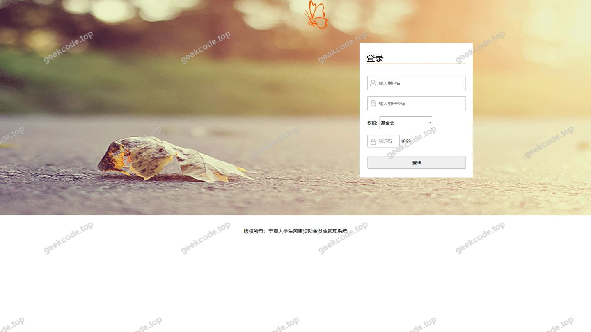</a>

<h4>页面-jiaoshixinxi列表</h4>

<a href="https://geekcode.top/archives/ssm%E5%AE%81%E5%A4%8F%E5%A4%A7%E5%AD%A6%E7%94%9F%E7%87%95%E5%AE%9D%E8%B5%84%E5%8A%A9%E9%87%91%E5%8F%91%E6%94%BE%E7%AE%A1%E7%90%86%E7%B3%BB%E7%BB%9F?utm_source=github" title="查看完整源码">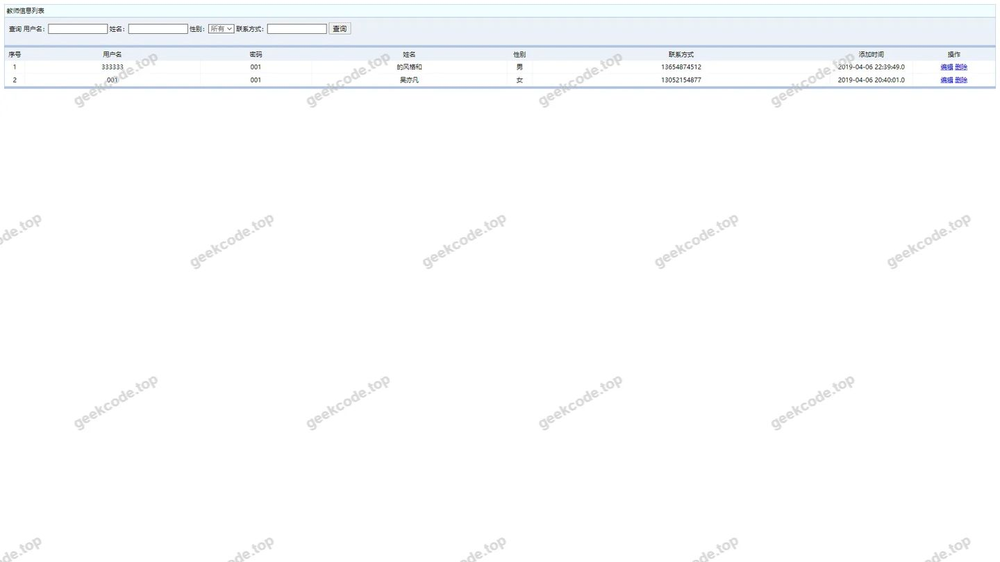</a>

<h4>页面-liuyanban列表</h4>

<a href="https://geekcode.top/archives/ssm%E5%AE%81%E5%A4%8F%E5%A4%A7%E5%AD%A6%E7%94%9F%E7%87%95%E5%AE%9D%E8%B5%84%E5%8A%A9%E9%87%91%E5%8F%91%E6%94%BE%E7%AE%A1%E7%90%86%E7%B3%BB%E7%BB%9F?utm_source=github" title="查看完整源码">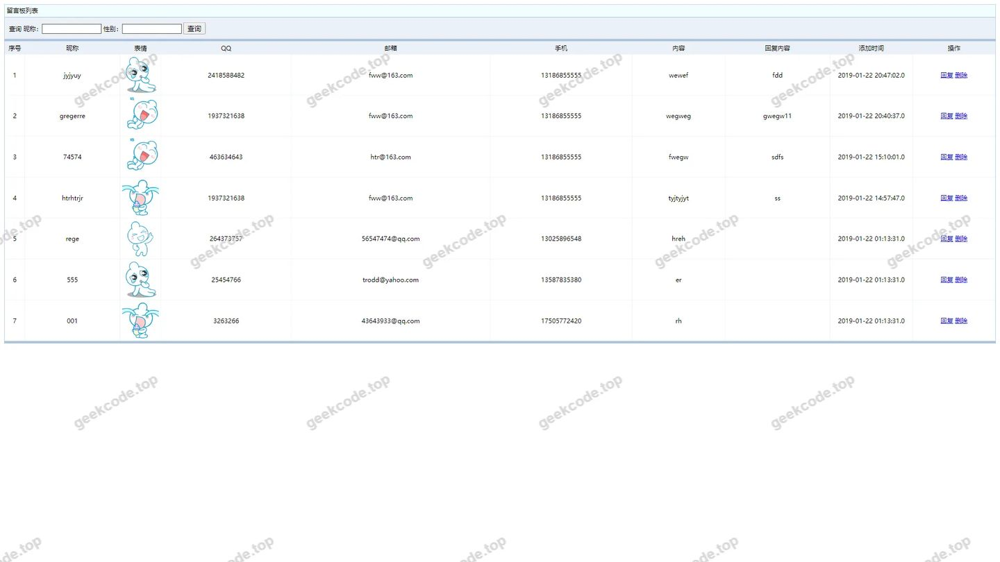</a>

<h4>页面-lyb列表</h4>

<a href="https://geekcode.top/archives/ssm%E5%AE%81%E5%A4%8F%E5%A4%A7%E5%AD%A6%E7%94%9F%E7%87%95%E5%AE%9D%E8%B5%84%E5%8A%A9%E9%87%91%E5%8F%91%E6%94%BE%E7%AE%A1%E7%90%86%E7%B3%BB%E7%BB%9F?utm_source=github" title="查看完整源码">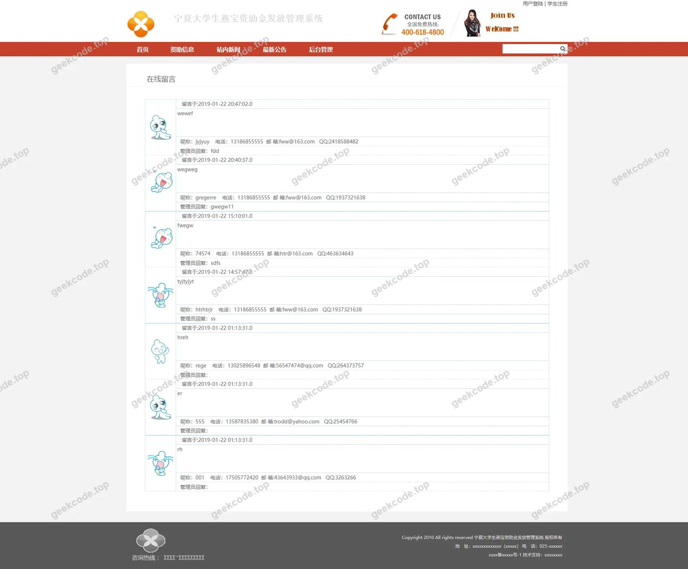</a>

<h4>页面-pinglun列表</h4>

<a href="https://geekcode.top/archives/ssm%E5%AE%81%E5%A4%8F%E5%A4%A7%E5%AD%A6%E7%94%9F%E7%87%95%E5%AE%9D%E8%B5%84%E5%8A%A9%E9%87%91%E5%8F%91%E6%94%BE%E7%AE%A1%E7%90%86%E7%B3%BB%E7%BB%9F?utm_source=github" title="查看完整源码">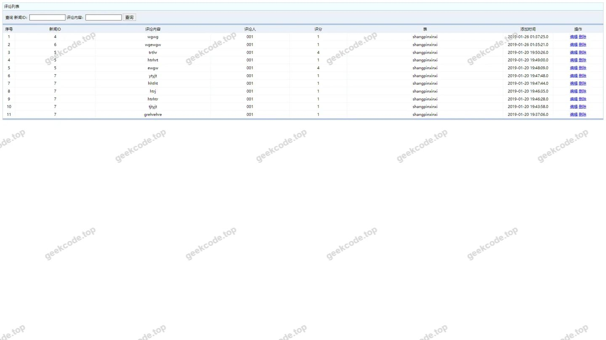</a>

<h4>页面-shenqinggenghuanyinxingka列表</h4>

<a href="https://geekcode.top/archives/ssm%E5%AE%81%E5%A4%8F%E5%A4%A7%E5%AD%A6%E7%94%9F%E7%87%95%E5%AE%9D%E8%B5%84%E5%8A%A9%E9%87%91%E5%8F%91%E6%94%BE%E7%AE%A1%E7%90%86%E7%B3%BB%E7%BB%9F?utm_source=github" title="查看完整源码">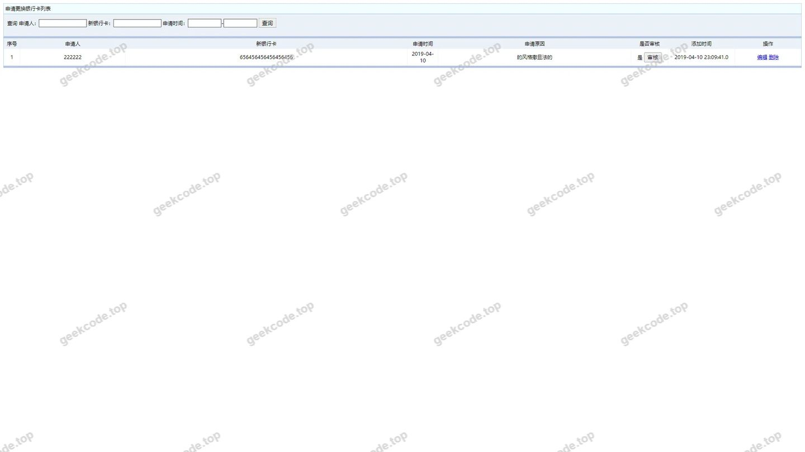</a>

<h4>页面-shenqingzizhu列表</h4>

<a href="https://geekcode.top/archives/ssm%E5%AE%81%E5%A4%8F%E5%A4%A7%E5%AD%A6%E7%94%9F%E7%87%95%E5%AE%9D%E8%B5%84%E5%8A%A9%E9%87%91%E5%8F%91%E6%94%BE%E7%AE%A1%E7%90%86%E7%B3%BB%E7%BB%9F?utm_source=github" title="查看完整源码">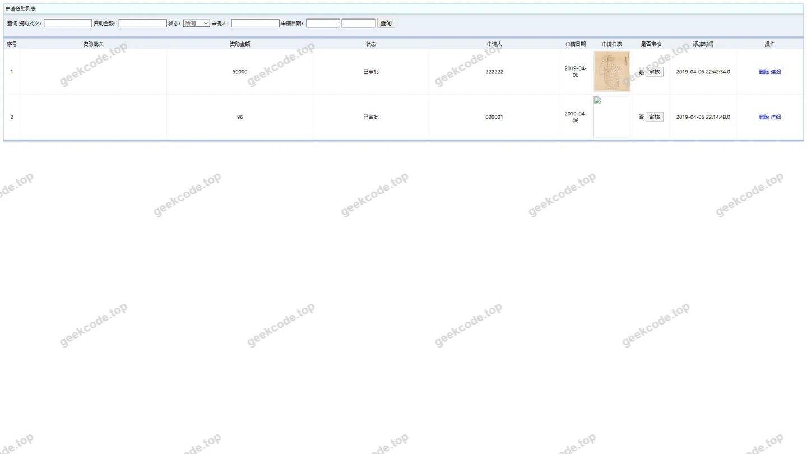</a>

<h4>页面-shoucangjilu列表</h4>

<a href="https://geekcode.top/archives/ssm%E5%AE%81%E5%A4%8F%E5%A4%A7%E5%AD%A6%E7%94%9F%E7%87%95%E5%AE%9D%E8%B5%84%E5%8A%A9%E9%87%91%E5%8F%91%E6%94%BE%E7%AE%A1%E7%90%86%E7%B3%BB%E7%BB%9F?utm_source=github" title="查看完整源码">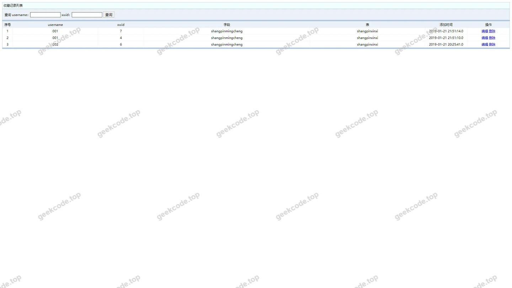</a>

<h4>页面-xinwentongzhi列表</h4>

<a href="https://geekcode.top/archives/ssm%E5%AE%81%E5%A4%8F%E5%A4%A7%E5%AD%A6%E7%94%9F%E7%87%95%E5%AE%9D%E8%B5%84%E5%8A%A9%E9%87%91%E5%8F%91%E6%94%BE%E7%AE%A1%E7%90%86%E7%B3%BB%E7%BB%9F?utm_source=github" title="查看完整源码">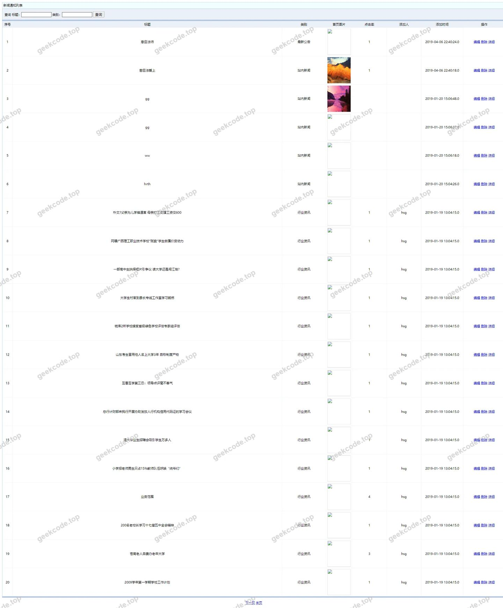</a>

<h4>页面-xueshengxinxi列表</h4>

<a href="https://geekcode.top/archives/ssm%E5%AE%81%E5%A4%8F%E5%A4%A7%E5%AD%A6%E7%94%9F%E7%87%95%E5%AE%9D%E8%B5%84%E5%8A%A9%E9%87%91%E5%8F%91%E6%94%BE%E7%AE%A1%E7%90%86%E7%B3%BB%E7%BB%9F?utm_source=github" title="查看完整源码">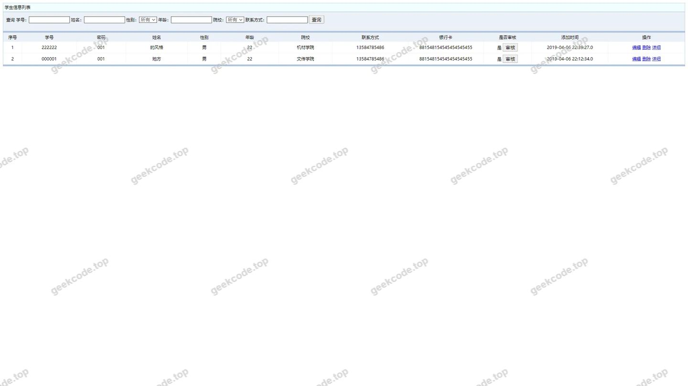</a>

<h4>页面-yonghuzhuce列表</h4>

<a href="https://geekcode.top/archives/ssm%E5%AE%81%E5%A4%8F%E5%A4%A7%E5%AD%A6%E7%94%9F%E7%87%95%E5%AE%9D%E8%B5%84%E5%8A%A9%E9%87%91%E5%8F%91%E6%94%BE%E7%AE%A1%E7%90%86%E7%B3%BB%E7%BB%9F?utm_source=github" title="查看完整源码">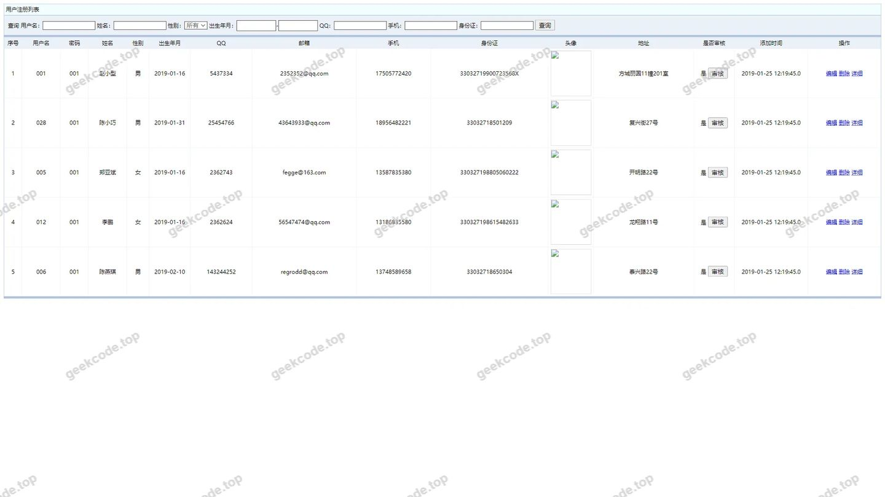</a>

<h4>页面-youqinglianjie列表</h4>

<a href="https://geekcode.top/archives/ssm%E5%AE%81%E5%A4%8F%E5%A4%A7%E5%AD%A6%E7%94%9F%E7%87%95%E5%AE%9D%E8%B5%84%E5%8A%A9%E9%87%91%E5%8F%91%E6%94%BE%E7%AE%A1%E7%90%86%E7%B3%BB%E7%BB%9F?utm_source=github" title="查看完整源码">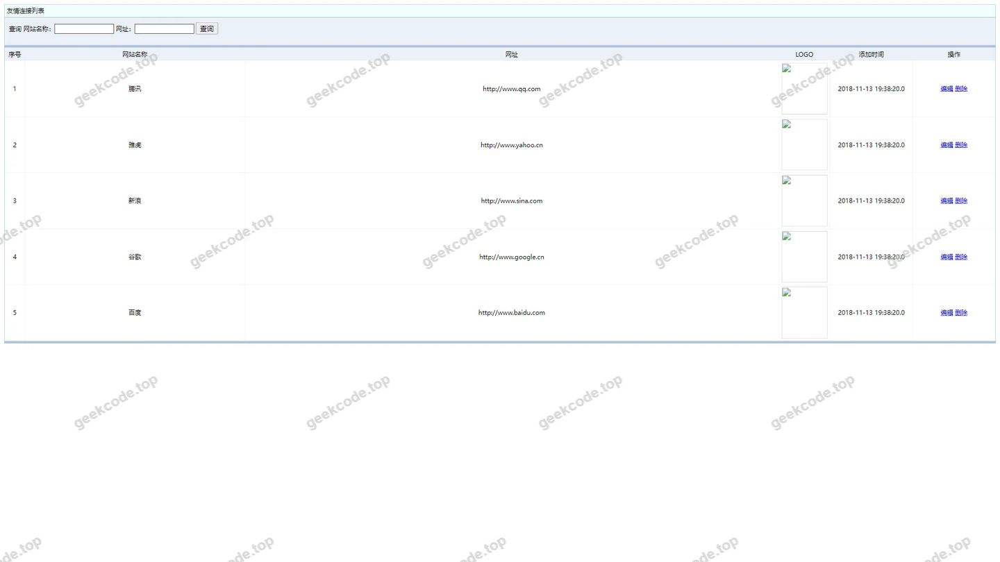</a>

<h4>页面-yuanxixinxi列表</h4>

<a href="https://geekcode.top/archives/ssm%E5%AE%81%E5%A4%8F%E5%A4%A7%E5%AD%A6%E7%94%9F%E7%87%95%E5%AE%9D%E8%B5%84%E5%8A%A9%E9%87%91%E5%8F%91%E6%94%BE%E7%AE%A1%E7%90%86%E7%B3%BB%E7%BB%9F?utm_source=github" title="查看完整源码">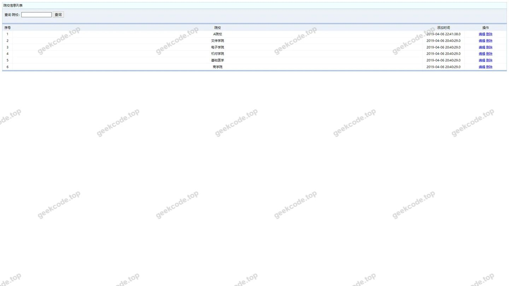</a>

<h4>页面-zizhuxinxi列表</h4>

<a href="https://geekcode.top/archives/ssm%E5%AE%81%E5%A4%8F%E5%A4%A7%E5%AD%A6%E7%94%9F%E7%87%95%E5%AE%9D%E8%B5%84%E5%8A%A9%E9%87%91%E5%8F%91%E6%94%BE%E7%AE%A1%E7%90%86%E7%B3%BB%E7%BB%9F?utm_source=github" title="查看完整源码">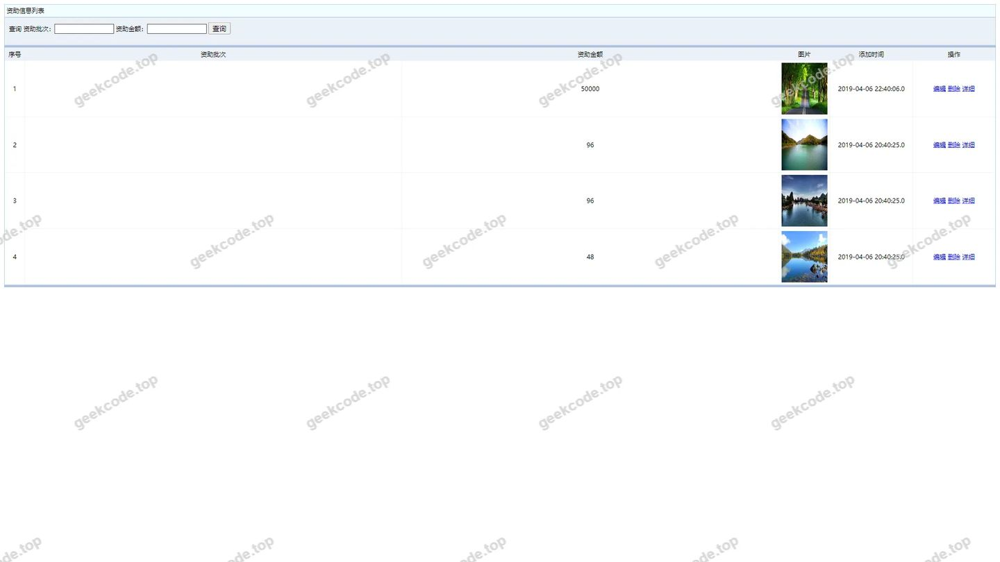</a>

<h4>页面-zzxx列表</h4>

<a href="https://geekcode.top/archives/ssm%E5%AE%81%E5%A4%8F%E5%A4%A7%E5%AD%A6%E7%94%9F%E7%87%95%E5%AE%9D%E8%B5%84%E5%8A%A9%E9%87%91%E5%8F%91%E6%94%BE%E7%AE%A1%E7%90%86%E7%B3%BB%E7%BB%9F?utm_source=github" title="查看完整源码">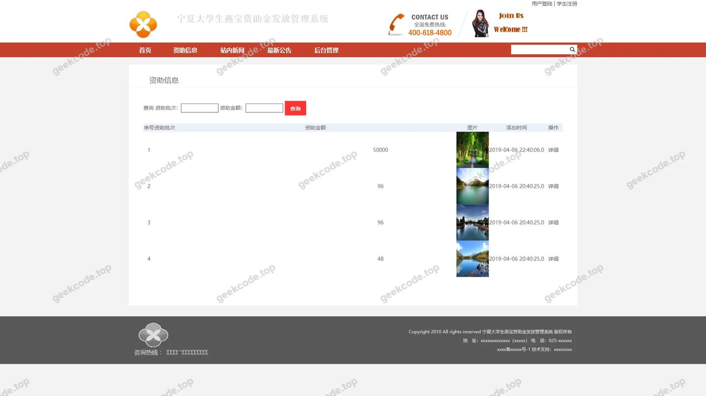</a>

<h4>页面-编辑</h4>

<a href="https://geekcode.top/archives/ssm%E5%AE%81%E5%A4%8F%E5%A4%A7%E5%AD%A6%E7%94%9F%E7%87%95%E5%AE%9D%E8%B5%84%E5%8A%A9%E9%87%91%E5%8F%91%E6%94%BE%E7%AE%A1%E7%90%86%E7%B3%BB%E7%BB%9F?utm_source=github" title="查看完整源码">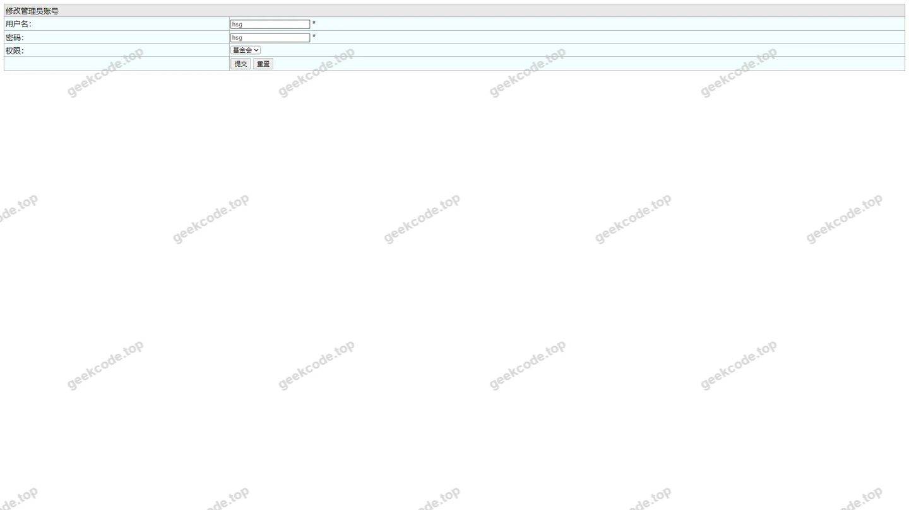</a>

<h3>后台管理端</h3>
<h4>页面-allusers列表</h4>

<a href="https://geekcode.top/archives/ssm%E5%AE%81%E5%A4%8F%E5%A4%A7%E5%AD%A6%E7%94%9F%E7%87%95%E5%AE%9D%E8%B5%84%E5%8A%A9%E9%87%91%E5%8F%91%E6%94%BE%E7%AE%A1%E7%90%86%E7%B3%BB%E7%BB%9F?utm_source=github" title="查看完整源码">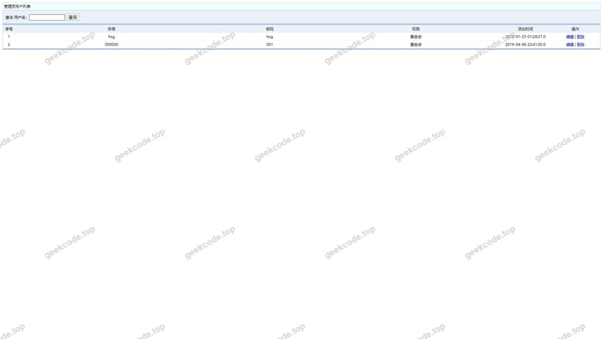</a>

---

## 获取完整源码

| 项目 | 说明 |
| --- | --- |
| 项目名 | ssm宁夏大学生燕宝资助金发放管理系统 |
| 运行截图 | 本文 17 张（站点带水印原图，仓库 `images/` 目录） |
| 完整源码 | [https://geekcode.top/archives/ssm%E5%AE%81%E5%A4%8F%E5%A4%A7%E5%AD%A6%E7%94%9F%E7%87%95%E5%AE%9D%E8%B5%84%E5%8A%A9%E9%87%91%E5%8F%91%E6%94%BE%E7%AE%A1%E7%90%86%E7%B3%BB%E7%BB%9F?utm_source=github](https://geekcode.top/archives/ssm%E5%AE%81%E5%A4%8F%E5%A4%A7%E5%AD%A6%E7%94%9F%E7%87%95%E5%AE%9D%E8%B5%84%E5%8A%A9%E9%87%91%E5%8F%91%E6%94%BE%E7%AE%A1%E7%90%86%E7%B3%BB%E7%BB%9F?utm_source=github) |
| 咨询微信 | **ir9372**（备注：jingpin-yuanma） |
| 更多项目 | [极客代码 geekcode.top](https://geekcode.top/?utm_source=github) |

> 需要源码、部署、改配置、跑不起来等问题，加微信 ir9372 沟通，说明项目名即可。
